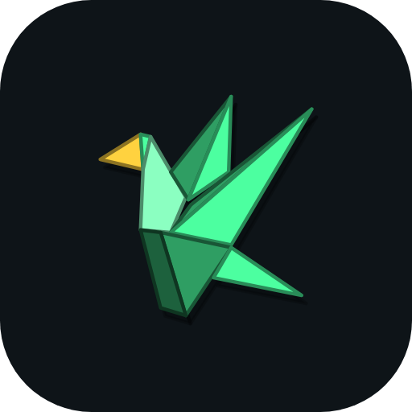
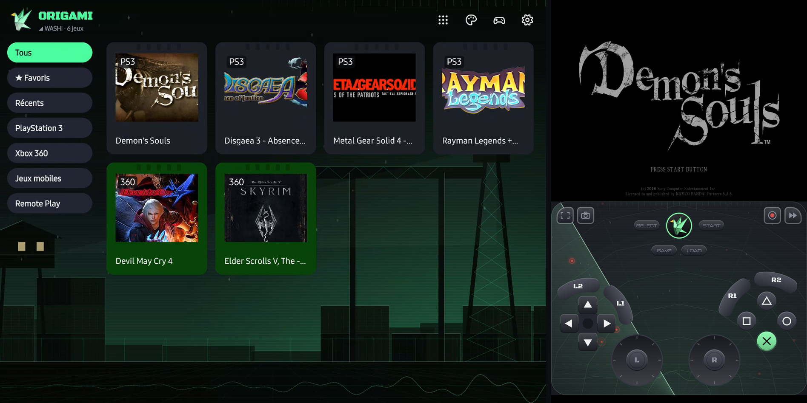
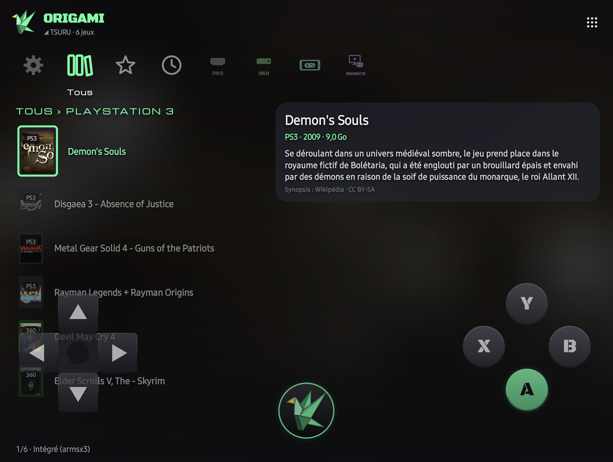
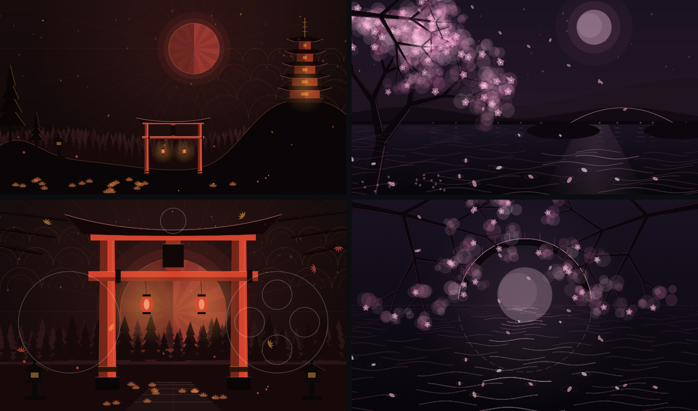

  

<h1 align="center">Origami</h1>

<b>Déplie. Joue.</b> par ORIKAMI

  <a href="https://github.com/orikami-dev/origami/releases/latest">⬇️ <b>Télécharger la dernière version</b></a>
  ·
  <a href="https://github.com/orikami-dev/origami/releases">📦 Toutes les versions</a>
  ·
  <a href="CHANGELOG.md">📝 Journal des versions</a>

---

## 🦢 Le projet

Origami réunit l'émulation et les jeux de ton téléphone pliant dans une seule app, pensée pour le pli : à moitié plié, l'écran du haut devient la console et celui du bas la manette.

  

  

| | |
|---|---|
| 🎮 **Mode Tsuru** | Téléphone à moitié plié : accueil façon XMB, jeu en haut, manette tactile en bas. |
| 📱 **Mode Washi** | Écran externe ou téléphone à plat : bibliothèque et lanceur d'apps. |
| 🕹️ **Manette Flex** | Une manette par console, choisie au lancement, qui suit la rotation. |
| 📁 **Dossier Origami** | À l'installation, Origami crée `Origami/GAMES` (avec `GAMES/DLC`) et `Origami/BIOS` à la racine du téléphone. |
| 🌐 **10 langues** | Français, anglais, espagnol, allemand, italien, portugais, russe, japonais, coréen, chinois. |
| 🔄 **Mises à jour intégrées** | Versions stables et préversions proposées directement dans l'app. |

## 🎨 Huit thèmes

Chaque thème a son fond animé, sa manette assortie, ses icônes, sa police, ses bruitages et sa musique.

| Thème | En une phrase |
|---|---|
| 📡 **Vigie** | Un faisceau radar qui veille dans la nuit verte. |
| ❄️ **Aurore** | Une nuit polaire sous les aurores. |
| ⛩️ **Torii** | Une pagode et un torii vermillon sous la lune rouge. |
| 🌸 **Hanami** | Un cerisier en fleurs au-dessus de la rivière et du pont de lune. |
| 🏙️ **Mégapole** | Une ville japonaise la nuit, avec ses tours et ses projecteurs. |
| 🌧️ **Averse** | Une ruelle de Tokyo sous la pluie et ses néons. |
| 🎋 **Brume** | Un temple de montagne dans la brume, ses lanternes et ses lucioles. |
| 🌕 **Clair de lune** | Une grue en origami sous la pleine lune. |

  

## 🧩 Consoles

| Génération | Consoles | Moteur |
|---|---|---|
| 8 et 16 bits | NES, SNES, Mega Drive, Game Boy, GBA… | cœurs libretro |
| 32 et 64 bits | PS1, N64, Saturn, Dreamcast, PSP, arcade | cœurs libretro |
| 6e génération | PS2 🟢, GameCube et Wii | ARMSX2, Dolphin |
| 7e génération | PS3 🧪, Xbox 360 🧪 | ARMSX3, Xenia (portage Android maison) |
| À venir | 3DS, Switch, PS Vita | en préparation |

🧪 = en test. Aucun jeu, BIOS ni firmware n'est fourni : tu utilises tes propres copies.

## ✨ Points forts

- 🧠 Répartition des cœurs (PS3 et Xbox 360) : le son, le rendu et le jeu sur les gros cœurs, les shaders sur les moyens ; mode Économie pour moins chauffer.
- ⚡ Profils Performance, Équilibré et Personnalisé ; PS3 en 720p (Performance) ou 1080p (Équilibré).
- 📸 Touches Capture d'écran et Vidéo sur toutes les manettes.
- 🏮 Lumen : lumière d'ambiance autour de l'écran du jeu, aux couleurs de l'image ou du thème.
- 📊 ATH façon RTSS sur toutes les consoles : images/s, vitesse, processeur, mémoire, batterie, chauffe.
- 📲 En portrait, écran du jeu et manette coupés pile sur la charnière ; en paysage, plein écran.
- 🗂️ Lanceur d'apps avec tri, grille ou liste et défilement rapide.
- 📡 Colonne Remote Play (PlayStation, Xbox, Steam Link) et colonne Jeux mobiles.
- 💾 Import et export des sauvegardes, import des BIOS et du firmware PS3.
- 📐 Tous les pliants et tous les formats d'écran, changements à chaud.

## ⭐ Mises à jour majeures

| Version | Ce qu'elle a apporté |
|---|---|
| [0.67.6](https://github.com/orikami-dev/origami/releases/tag/v0.67.6) | Didacticiel à bulles, journal envoyé par mail en un geste, notes de mise à jour détaillées. |
| [0.67.3](https://github.com/orikami-dev/origami/releases/tag/v0.67.3) | Précompilation PS3 : suivi en direct dans la notification. |
| [0.67.2](https://github.com/orikami-dev/origami/releases/tag/v0.67.2) | Sauvegarde et chargement rapides en pictogrammes, 10 appuis sur le logo plus fiables. |
| [0.67.1](https://github.com/orikami-dev/origami/releases/tag/v0.67.1) | Turnip : détection du GPU sur tous les téléphones Android. |
| [0.67.0](https://github.com/orikami-dev/origami/releases/tag/v0.67.0) | Débogage et préversions cachés derrière le logo, précompilation PS3 sur tous les cœurs. |
| [0.66.25](https://github.com/orikami-dev/origami/releases/tag/v0.66.25) | PS3 : choix du pilote graphique (Auto ou Turnip). |
| [0.66.24](https://github.com/orikami-dev/origami/releases/tag/v0.66.24) | Répartition des cœurs, dossier Origami à la racine, fonds Torii et Hanami refaits. |
| [0.66.21](https://github.com/orikami-dev/origami/releases/tag/v0.66.21) | Thèmes renommés, touches Capture et Vidéo. |
| [0.66.19](https://github.com/orikami-dev/origami/releases/tag/v0.66.19) | Manettes animées pour tous les thèmes. |
| [0.66.13](https://github.com/orikami-dev/origami/releases/tag/v0.66.13) | Nouveau logo : la grue en vol. |
| [0.66.7](https://github.com/orikami-dev/origami/releases/tag/v0.66.7) | Trois nouveaux thèmes, huit musiques. |
| [0.65.24](https://github.com/orikami-dev/origami/releases/tag/v0.65.24) | Sons système propres à chaque thème (suivant, onglet, activé, erreur, terminé). |
| [0.65.18](https://github.com/orikami-dev/origami/releases/tag/v0.65.18) | Andon : lumière d'ambiance autour de l'écran du jeu. |
| [0.65.11](https://github.com/orikami-dev/origami/releases/tag/v0.65.11) | Préversions dans l'app : les nouveaux builds apparaissent seuls. |
| [0.62.0](https://github.com/orikami-dev/origami/releases/tag/v0.62.0) | Sons et musiques par thème, Remote Play par plateforme, jaquettes Xbox 360. |
| [0.60.0](https://github.com/orikami-dev/origami/releases/tag/v0.60.0) | Xbox 360 intégrée (portage Android de Xenia). |
| [0.50.1](https://github.com/orikami-dev/origami/releases/tag/v0.50.1) | PS3 intégrée (ARMSX3). |
| [0.50.0](https://github.com/orikami-dev/origami/releases/tag/v0.50.0) | Thèmes sans redémarrage, en route vers la PS3. |
| [0.41.0](https://github.com/orikami-dev/origami/releases/tag/v0.41.0) | Réglages en deux volets et 10 langues. |
| [0.40.0](https://github.com/orikami-dev/origami/releases/tag/v0.40.0) | Accueil façon XMB et navigation à la manette partout. |
| [0.29.0](https://github.com/orikami-dev/origami/releases/tag/v0.29.0) | L'app devient Origami. |
| [0.25.0](https://github.com/orikami-dev/origami/releases/tag/v0.25.0) | GameCube et Wii intégrées (Dolphin). |
| [0.23.0](https://github.com/orikami-dev/origami/releases/tag/v0.23.0) | PS2 intégrée (ARMSX2). |
| [0.21.0](https://github.com/orikami-dev/origami/releases/tag/v0.21.0) | La 3D : N64, PSP et Dreamcast en OpenGL ES. |
| [0.8.0](https://github.com/orikami-dev/origami/releases/tag/v0.8.0) | Moteur d'émulation intégré : les jeux tournent dans Origami, manette en bas. |
| [0.1.0](https://github.com/orikami-dev/origami/releases/tag/v0.1.0) | Premier build : lanceur rétro pensé pour le Galaxy Fold. |

## 🛠️ Le dépôt

| Dossier | Contenu |
|---|---|
| `app/` | L'app Android (Java, sans Gradle) et `build.sh` |
| `native/` | Pont libretro, pont PS3, scripts de compilation et correctifs des moteurs |
| `prebuilt/` | Moteurs compilés (non versionnés, refaits par `native/build-*.sh`) |
| `docs/` | Notes de chaque version (`docs/releases`), images |
| `tools/` | Installation du SDK, publication des versions |

Construire : `bash app/build.sh` (voir l'en-tête du script).

## ⚖️ Licences

Le code des moteurs intégrés garde sa licence : ARMSX2 (GPL-3.0), ARMSX3 (GPL-2.0), Dolphin (GPL-2.0+), Xenia (BSD-3). Leurs sources modifiées sont publiées avec l'app. Origami n'est affilié à aucun constructeur de consoles.
