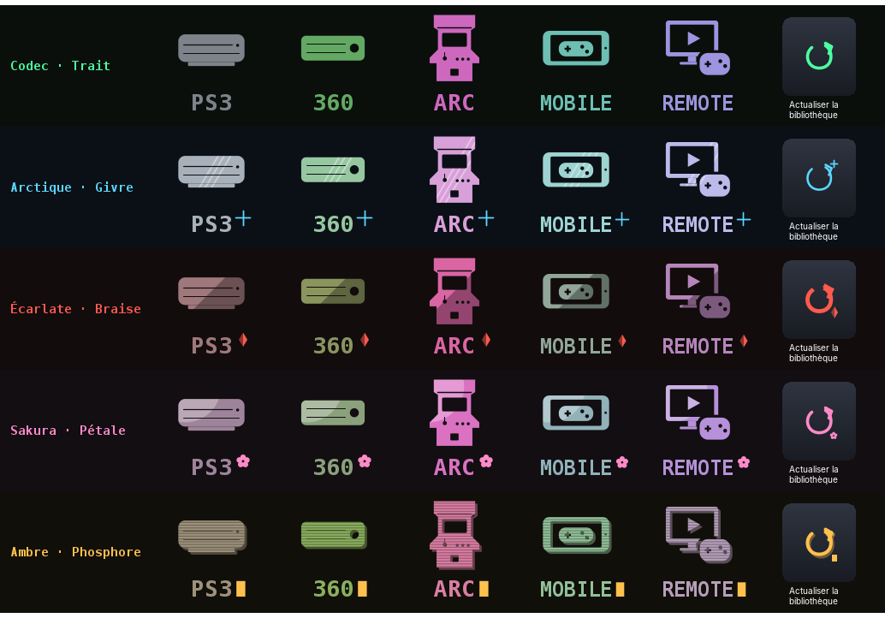
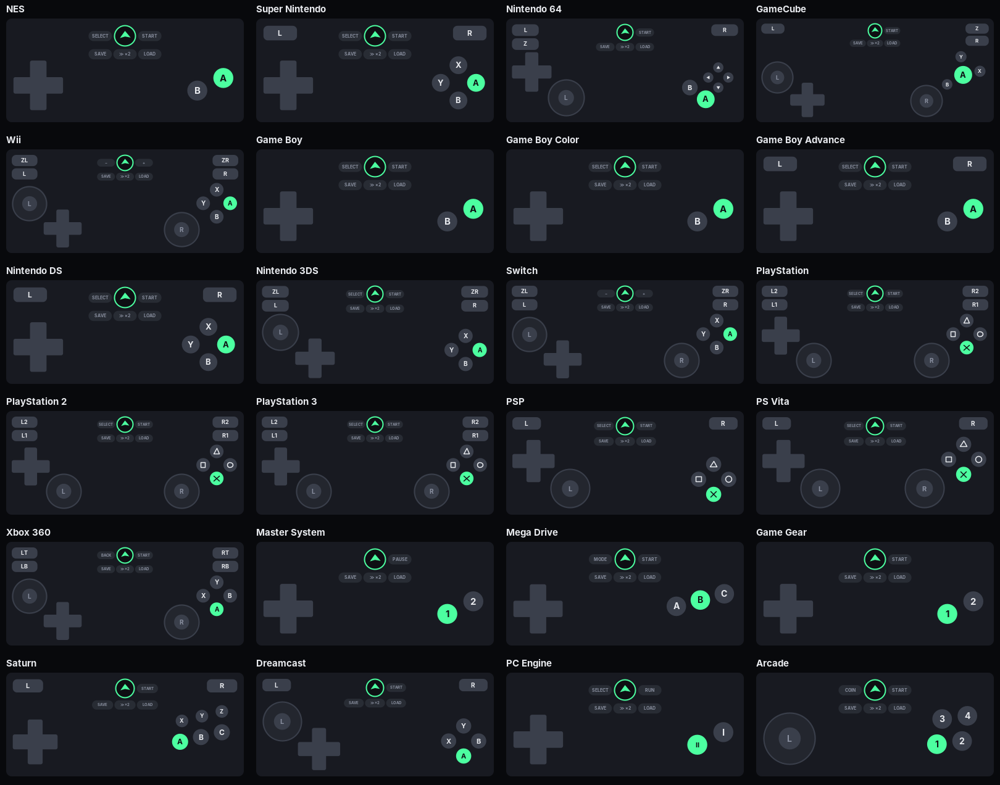
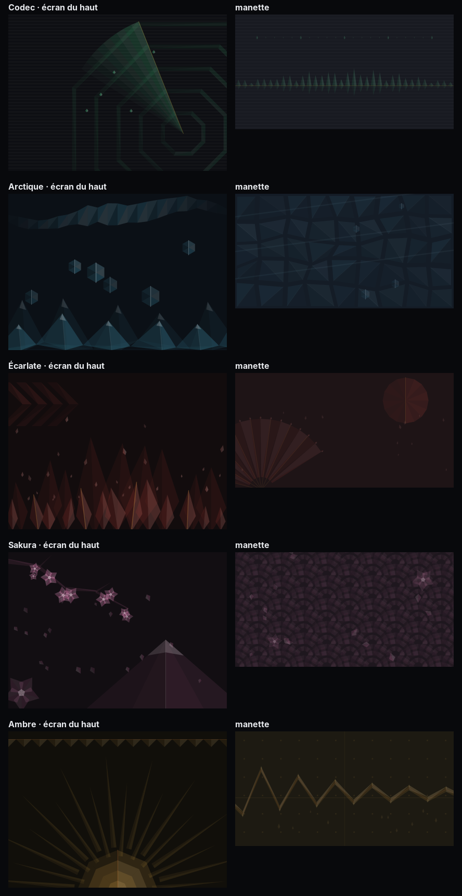

  

<h1 align="center">Origami</h1>

<b>Déplie. Joue.</b> par KAMI-WORKS

  <a href="https://github.com/orikami-dev/origami/releases/latest">⬇️ <b>Télécharger la dernière version</b></a>
  ·
  <a href="https://github.com/orikami-dev/origami/releases">📦 Toutes les versions</a>
  ·
  <a href="CHANGELOG.md">📝 Journal des versions</a>

---

## 🦢 Le projet

Origami réunit l'émulation et les jeux de ton téléphone pliant dans une seule app, pensée pour le pli : à moitié plié, l'écran du haut devient la console et celui du bas la manette.

| | |
|---|---|
| 🎮 **Mode Tsuru** | Téléphone à moitié plié : accueil façon XMB, jeu en haut, manette tactile en bas. |
| 📱 **Mode Washi** | Écran externe ou téléphone à plat : lanceur d'apps et bibliothèque. |
| 🕹️ **Manette Flex** | Une manette par console, choisie au lancement, qui suit la rotation. |
| 🌐 **10 langues** | Français, anglais, espagnol, allemand, italien, portugais, russe, japonais, coréen, chinois. |

  
  

## 🧩 Consoles

| Génération | Consoles | Moteur |
|---|---|---|
| 8 et 16 bits | NES, SNES, Mega Drive, Game Boy, GBA… | cœurs libretro |
| 32 et 64 bits | PS1, N64, Saturn, Dreamcast, PSP, arcade | cœurs libretro |
| 6e génération | PS2 🟢, GameCube et Wii | ARMSX2, Dolphin |
| 7e génération | PS3 🧪, Xbox 360 🧪 | ARMSX3, Xenia (portage Android maison) |

🧪 = en test. Aucun jeu, BIOS ni firmware n'est fourni : tu utilises tes propres copies.

## ✨ Points forts

- 🎨 Cinq thèmes (Codec, Arctique, Écarlate, Sakura, Ambre) appliqués sans redémarrage, avec fonds, manettes et icônes assortis.
- 📊 ATH façon RTSS sur toutes les consoles : images/s, vitesse, processeur, mémoire, batterie, chauffe.
- ⚡ Profils Performance, Équilibré, Qualité qui règlent vraiment chaque moteur.
- 📡 Colonne Remote Play (PlayStation, Xbox, Steam Link) et colonne Jeux mobiles.
- 💾 Import et export des sauvegardes, import des BIOS et du firmware PS3.
- 📐 Tous les pliants et tous les formats d'écran, changements à chaud.

  

## ⭐ Mises à jour majeures

| Version | Ce qu'elle a apporté |
|---|---|
| [0.60.0](https://github.com/orikami-dev/origami/releases/tag/v0.60.0) | Xbox 360 intégrée (portage Android de Xenia). |
| [0.50.1](https://github.com/orikami-dev/origami/releases/tag/v0.50.1) | PS3 intégrée (ARMSX3). |
| [0.50.0](https://github.com/orikami-dev/origami/releases/tag/v0.50.0) | Thèmes sans redémarrage, en route vers la PS3. |
| [0.41.0](https://github.com/orikami-dev/origami/releases/tag/v0.41.0) | Réglages en deux volets et 10 langues. |
| [0.40.0](https://github.com/orikami-dev/origami/releases/tag/v0.40.0) | Accueil façon XMB et navigation à la manette partout. |
| [0.29.0](https://github.com/orikami-dev/origami/releases/tag/v0.29.0) | L'app devient Origami. |
| [0.25.0](https://github.com/orikami-dev/origami/releases/tag/v0.25.0) | GameCube et Wii intégrées (Dolphin). |
| [0.23.0](https://github.com/orikami-dev/origami/releases/tag/v0.23.0) | PS2 intégrée (ARMSX2). |
| [0.21.0](https://github.com/orikami-dev/origami/releases/tag/v0.21.0) | La 3D : N64, PSP et Dreamcast en OpenGL ES. |
| [0.8.0](https://github.com/orikami-dev/origami/releases/tag/v0.8.0) | Moteur d'émulation intégré : les jeux tournent dans Origami, manette en bas. |
| [0.1.0](https://github.com/orikami-dev/origami/releases/tag/v0.1.0) | Premier build : lanceur rétro pensé pour le Galaxy Fold. |

## 🛠️ Le dépôt

| Dossier | Contenu |
|---|---|
| `app/` | L'app Android (Java, sans Gradle) et `build.sh` |
| `native/` | Pont libretro, pont PS3, scripts de compilation et correctifs des moteurs |
| `prebuilt/` | Moteurs compilés (non versionnés, refaits par `native/build-*.sh`) |
| `docs/` | Notes techniques, notes de chaque version, images |
| `tools/` | Installation du SDK |

Construire : `bash app/build.sh` (voir l'en-tête du script).

## ⚖️ Licences

Le code des moteurs intégrés garde sa licence : ARMSX2 (GPL-3.0), ARMSX3 (GPL-2.0), Dolphin (GPL-2.0+), Xenia (BSD-3). Leurs sources modifiées sont publiées avec l'app. Origami n'est affilié à aucun constructeur de consoles.
